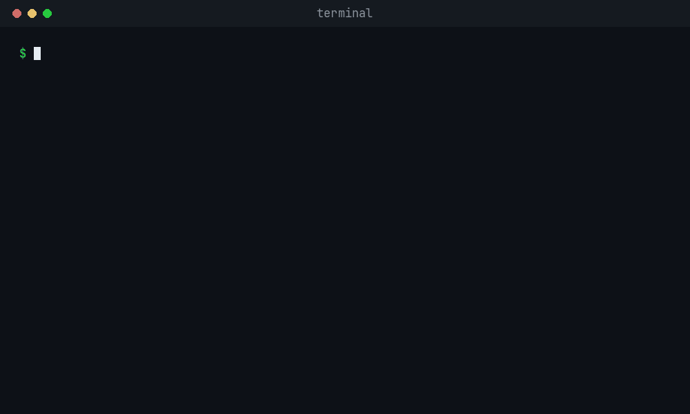

<div align="center">

# Obi's brain

**Give your AI agent a sales brain in one line.**

```
npx @outbindai/cli learn yourcompany.com
```



</div>

---

Point it at any company's website. In about 20 seconds you get `brain.md`: who they sell to, the people who buy, the problems they solve, the objections to expect and how they sound.

No account, no API key, no setup.

## Use it from your AI agent

Coding agents and AI assistants can run commands for you, so just ask:

> "Learn my company from acme.com and write me a first email to a dental clinic owner."

The agent runs `outbind learn`, reads `brain.md` and writes from it.

Prefer a chat app? Run `npx @outbindai/cli mcp` to connect Outbind to your AI assistant.

## Free preview vs free account

`learn` is free and reads one page. A free Outbind account grows the brain:

| | No account | Free account |
| --- | :---: | :---: |
| `brain.md` from a website | ✓ | ✓ |
| Learns from your decks, docs and notes | | ✓ |
| Remembers every prospect between sessions | | ✓ |
| Writes emails from your brain | | ✓ |
| Learns from your edits and what gets replies | | ✓ |
| Free email verifier | | ✓ |

Make one from the terminal (you type the 6-digit code from your email):

```
npx @outbindai/cli signup you@company.com
```

Or sign up at [outbind.ai](https://app.outbind.ai/sign-up?utm_source=github&utm_medium=readme&utm_campaign=obi_brain).

## Commands

```
outbind learn <website>        Any company's website -> brain.md (no account)
outbind signup <email>         Free account, from the terminal
outbind login                  Sign in with your browser
outbind docs add <file>        Teach the brain from PDF, Word, PowerPoint, text, Markdown or CSV
outbind docs                   What the brain learned
outbind tools                  The brain tools you can run
outbind run <tool> k=v         Run one
outbind mcp                    Connect Outbind to your AI assistant
outbind help                   Everything else
```

Needs Node 20 or newer. No dependencies.

To install it globally: `npm install -g @outbindai/cli`, then use `outbind` directly.

## Playbook

[`playbook/first-emails.md`](playbook/first-emails.md) has plain-English notes on writing first emails that get replies. Agents can read it directly.

## Privacy and safety

- This is the open-source client. The brain lives on Outbind's servers.
- It never sends emails, finds leads or spends money for you.
- `learn` reads only a site's public home page and respects its robots.txt.
- Your sign-in is saved only on your computer (`~/.config/outbind`). Remove it with `outbind logout`.

## License

[MIT](LICENSE)
